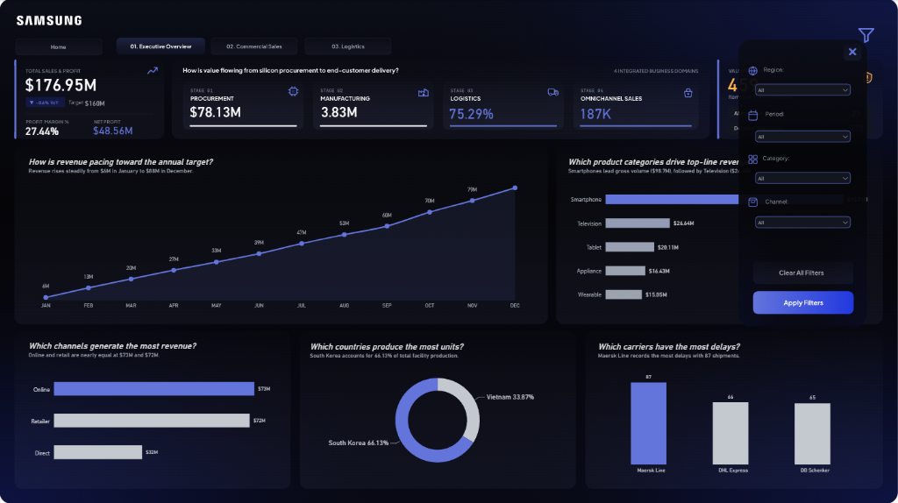
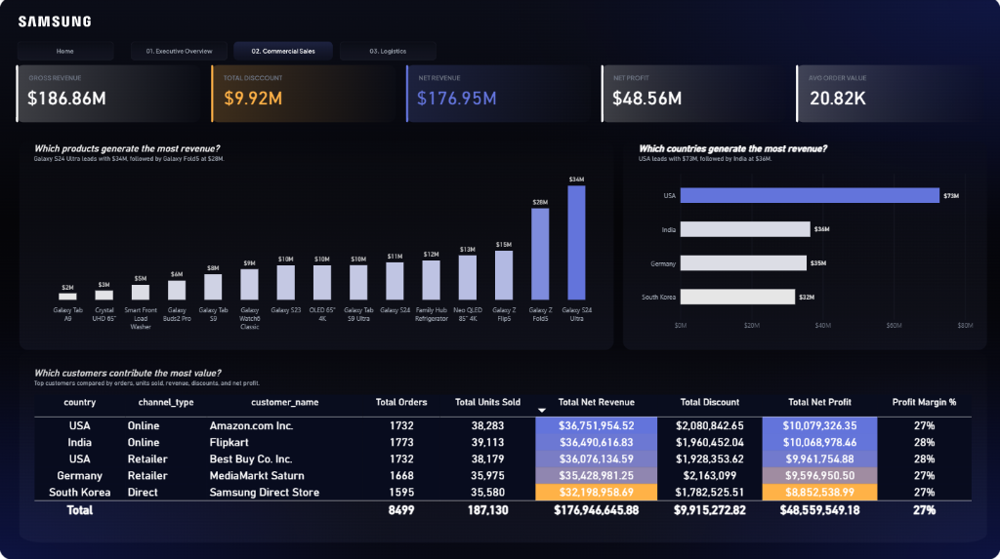
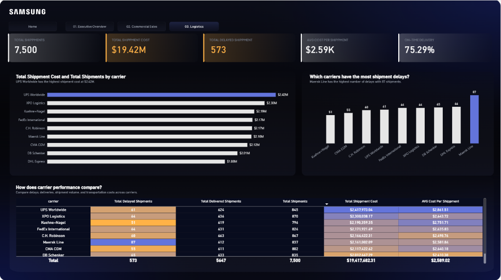
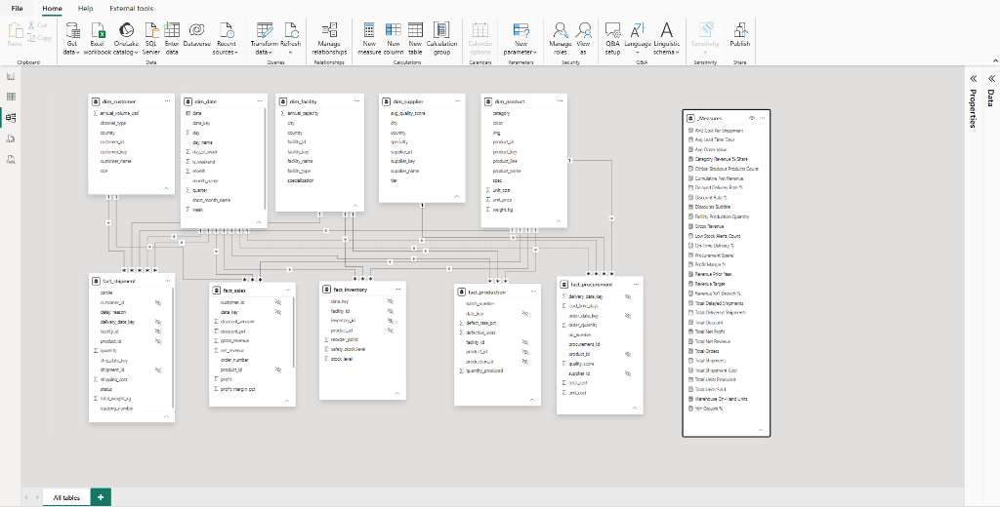

# Samsung Global Performance & Supply Chain Analytics Dashboard

<div align="center">


### An End-to-End Enterprise Power BI Solution Diagnosing Value Chain Flow, Commercial Velocity, and Freight Fulfillment for Samsung Electronics

[📊 Live Portfolio Overview](https://nady-07.github.io/portfolio/#projects) · [📥 Download .PBIX File](./Samsung%20Dashboard.pbix) · [💼 Connect on LinkedIn](https://www.linkedin.com/in/mohamed-alnady-52b87123b)

</div>

---

## 📌 Executive Summary

Modern consumer tech enterprises operate complex global supply networks where top-line commercial momentum can often mask severe operational vulnerabilities upstream. 

This enterprise analytics suite connects **4 integrated business domains** across Samsung's global operations—from raw silicon procurement and multi-country manufacturing to freight carrier logistics and omnichannel commercial sales. 

Built using a **Multi-Fact Constellation Schema** (5 Dimension tables, 5 Fact tables, and 30+ centralized DAX measures), the dashboard delivers real-time visibility into **$176.95M in net revenue**, evaluates **$19.42M in freight spend** across 7,500 global shipments, and isolates **459 value-at-risk inventory items** to safeguard fulfillment ahead of peak retail demand.

---

## 🚀 Key Business Metrics & Findings

| Metric Domain | KPI | Value | Business Context & Insight |
| :--- | :--- | :--- | :--- |
| **Commercial Top-Line** | Net Revenue | **$176.95M** | **+10.6%** above $160M target (-0.6% YoY pacing) across 187,130 units. |
| **Profitability** | Net Operating Profit | **$48.56M** | **27.44%** net profit margin achieved on $186.86M gross sales. |
| **Commercial Leakage** | Total Discounts | **$9.92M** | 5.3% gross discount leakage across online and retail accounts. |
| **Upstream Procurement** | Silicon & Parts Spend | **$78.13M** | Average supplier component lead time maintained at 11.5 days. |
| **Global Manufacturing** | Total Production | **3.83M Units** | Production split: **66.13% South Korea** (2.53M) and **33.87% Vietnam** (1.30M). |
| **Logistics Fulfillment** | Total Shipments | **7,500** | Total freight spend of **$19.42M** across 8 international carrier partners. |
| **Delivery Reliability** | On-Time Delivery % | **75.29%** | 5,647 delivered on-time; **573 delayed shipments** creating partner lag. |
| **Fulfillment Cost** | Avg. Freight Cost / Shipment | **$2,589** | Cost ranges from $2,410 (DB Schenker) up to $2,861 (UPS Worldwide). |
| **Supply Chain Exposure** | Value-at-Risk SKUs | **459 Items** | **25 critical SKUs** near total stockout, threatening $8M+ in unfulfilled orders. |

---

## 📸 Dashboard Walkthrough & Architecture

### Page 1: Executive Overview & Value Chain Journey
Diagnoses enterprise-wide health, connects the 4-stage value flow, and tracks monthly revenue pacing toward the annual target. Features a slide-out custom filter drawer.



* **4-Stage Value Chain Flow:** Stage 01 Procurement ($78.13M) ➔ Stage 02 Manufacturing (3.83M units) ➔ Stage 03 Logistics (75.29% on-time) ➔ Stage 04 Omnichannel Sales (187K units / $176.95M).
* **Revenue Pacing:** Tracks cumulative revenue pacing steadily upward from $6M (Jan) to $88M (Dec), closing the fiscal year +$16.95M over the $160M budget.
* **Category Breakdown:** Smartphones dominate gross revenue (**$98.71M**), followed by Televisions ($26.64M), Tablets ($20.11M), Home Appliances ($16.43M), and Wearables ($15.05M).
* **Channel Distribution:** Balanced omnichannel split between Online ($73M) and Retailers ($72M), with Samsung Direct stores contributing $32M.
* **Friction Identification:** Highlights 573 delayed shipments and 459 stockout alert items.

---

### Page 2: Commercial Sales & Key Accounts
Deep-dives into product-level revenue contribution, geographic demand, and tier-1 retail customer concentration.



* **Flagship Device Velocity:** **Galaxy S24 Ultra** leads all products with **$34M**, followed by the **Galaxy Z Fold5** ($28M) and **Galaxy Z Flip5** ($15M).
* **Regional Contribution:** The United States represents the largest market (**$73M**), followed by India ($36M), Germany ($35M), and South Korea ($32M).
* **Tier-1 Account Matrix:**
  * **Amazon.com Inc.** (USA, Online): 1,732 orders · $36.75M net revenue · $10.08M profit (27% margin)
  * **Flipkart** (India, Online): 1,773 orders · $36.49M net revenue · $10.07M profit (28% margin)
  * **Best Buy Co. Inc.** (USA, Retailer): 1,732 orders · $36.08M net revenue · $9.96M profit (28% margin)
  * **MediaMarkt Saturn** (Germany, Retailer): 1,668 orders · $35.43M net revenue · $9.60M profit (27% margin)
  * **Samsung Direct Store** (South Korea, Direct): 1,595 orders · $32.20M net revenue · $8.85M profit (27% margin)

---

### Page 3: Logistics & Carrier Optimization
Evaluates carrier freight costs, delivery timelines, volume commitments, and SLA penalty liabilities across 8 global logistics partners.



* **Carrier Spend Distribution:** UPS Worldwide absorbs the largest freight spend (**$2.42M** at $2,861 avg cost), followed by XPO Logistics ($2.30M), Kuehne+Nagel ($2.19M), and FedEx International ($2.17M).
* **Carrier Delay Concentration:** **Maersk Line** records the highest number of delays (**87 shipments**, 10.4% delay rate), whereas **Kuehne+Nagel** demonstrated best-in-class reliability with only 51 delays across 796 shipments.
* **Freight Unit Economics:** Carrier unit costs span from a low of $2,410.38 (DB Schenker) to $2,861.51 (UPS Worldwide), identifying an immediate optimization seam for contract renegotiation.

---

### Data Model: Multi-Fact Constellation Architecture
To cleanly support cross-functional reporting without circular dependencies or high-cardinality M:M relationships, the data model was structured as an enterprise **Constellation Schema**.



* **5 Dimensional Tables (Conformed Dimensions):**
  * `dim_customer` — Customer demographics, tiering, channel classification, and annual volume.
  * `dim_date` — Full Gregorian calendar table with fiscal periods, month offsets, and day flags.
  * `dim_facility` — Manufacturing and assembly plants, capacities, and country locations.
  * `dim_supplier` — Tier ratings, component categories, country, and historical quality scores.
  * `dim_product` — SKU hierarchies, categories, product lines, weights, and unit economics.
* **5 Fact Tables:**
  * `fact_sales` — Order transactions, gross revenue, discount allocations, and realized net profit.
  * `fact_shipment` — Freight carrier handoffs, tracking, transit times, shipping fees, and SLA status.
  * `fact_inventory` — Warehouse stock balances, reorder points, and safety stock thresholds.
  * `fact_production` — Daily facility manufacturing runs, produced volume, and defect counts.
  * `fact_procurement` — Purchase orders, silicon quantities, delivery lead times, and unit costs.
* **Centralized `_Measures` Table:** Eliminates measure dispersion by housing all business logic in a dedicated calculation group.

---

## 🧮 Selected DAX Measures Catalog

All business metrics were engineered using strict performance-first DAX patterns, leveraging `DIVIDE` for safe division and explicit filter context management:

### 1. Financial & Performance Core
```dax
// Total realized net revenue after promotional discounts
[Total Net Revenue] = 
SUM(fact_sales[net_revenue])

// Total operating net profit
[Total Net Profit] = 
SUM(fact_sales[profit])

// Operating profit margin percentage
[Profit Margin %] = 
DIVIDE(
    [Total Net Profit],
    [Total Net Revenue],
    0
)

// Cumulative Year-to-Date revenue pacing curve
[Cumulative Net Revenue] = 
CALCULATE(
    [Total Net Revenue],
    FILTER(
        ALLSELECTED(dim_date),
        dim_date[date] <= MAX(dim_date[date])
    )
)

// Year-over-Year Net Revenue variance
[Revenue YoY Growth %] = 
VAR _CurrentRev = [Total Net Revenue]
VAR _PriorYearRev = CALCULATE([Total Net Revenue], SAMEPERIODLASTYEAR(dim_date[date]))
RETURN
DIVIDE(_CurrentRev - _PriorYearRev, _PriorYearRev, 0)
```

### 2. Supply Chain & Logistics Reliability
```dax
// On-time freight delivery percentage
[On-Time Delivery %] = 
VAR _Delivered = CALCULATE(COUNTROWS(fact_shipment), fact_shipment[status] = "Delivered")
VAR _Total = COUNTROWS(fact_shipment)
RETURN
DIVIDE(_Delivered, _Total, 0)

// Total delayed carrier shipments
[Total Delayed Shipments] = 
CALCULATE(
    COUNTROWS(fact_shipment),
    fact_shipment[status] = "Delayed"
)

// Average transportation fee per shipment
[Avg Cost Per Shipment] = 
DIVIDE(
    SUM(fact_shipment[shipping_cost]),
    COUNTROWS(fact_shipment),
    0
)

// Critical inventory stockout indicator
[Critical Stockout Products Count] = 
CALCULATE(
    DISTINCTCOUNT(fact_inventory[product_id]),
    fact_inventory[stock_level] <= fact_inventory[safety_stock_level]
)
```

---

## 💡 Strategic Recommendations & Action Playbook

Based on the quantitative findings surfaced by this dashboard, leadership has established a **90-Day Execution Roadmap**:

1. **Inventory War Room & Replenishment Blitz (Immediate — Days 1–15):**
   * Prioritize expedited production transfers from South Korea facilities to replenish the **25 critical SKUs** running near complete stockout.
   * Protect **$8M+** in at-risk commercial orders across tier-1 retail partners (Best Buy & MediaMarkt).
2. **Carrier SLA Enforcement & Volume Reallocation (Days 15–45):**
   * Reallocate **25% of container shipping volume away from Maersk Line** (87 delays) toward higher-reliability carriers such as **Kuehne+Nagel** (51 delays) and **CMA CGM**.
   * Institute strict transit-time penalties to recoup carrier delay losses.
3. **Commercial Discount Governance (Days 45–90):**
   * Institute a strict **5% cap** on discretionary account discounts. 
   * Reclaiming just 20% of the current **$9.92M discount leakage** yields an immediate **+$1.98M net profit expansion** with zero increase in operating overhead.

---

## 🛠️ How to Open & Inspect the Project

1. **Prerequisites:** Install [Microsoft Power BI Desktop](https://powerbi.microsoft.com/desktop/) (July 2024 or later recommended).
2. **Clone this repository:**
   ```bash
   git clone https://github.com/Nady-07/Samsung-Performance-Dashboard.git
   ```
3. **Open the report:** Double-click [`Samsung Dashboard.pbix`](./Samsung%20Dashboard.pbix) in Power BI Desktop.
4. **Explore the report:** Interact with the custom pop-out slicer drawer, examine the dimensional relationships in the Model View, and review the measures in `_Measures`.

---

## 👨‍💻 Author & Contact

**Mohamed Al Nady** — *Data Analyst specializing in SQL, Power BI, DAX, and Data Warehousing*
* 🌐 **Portfolio:** [nady-07.github.io/portfolio](https://nady-07.github.io/portfolio/)
* 💼 **LinkedIn:** [linkedin.com/in/mohamed-alnady-52b87123b](https://www.linkedin.com/in/mohamed-alnady-52b87123b)
* 📧 **Email:** [mohamednady0@outlook.com](mailto:mohamednady0@outlook.com)
* 🐙 **GitHub:** [@Nady-07](https://github.com/Nady-07)
